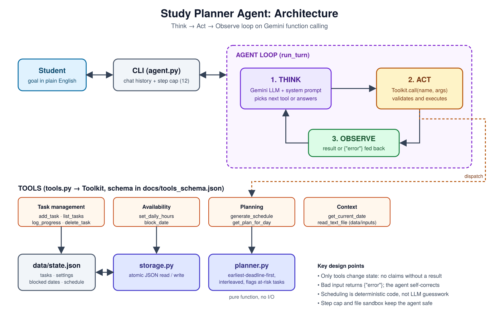
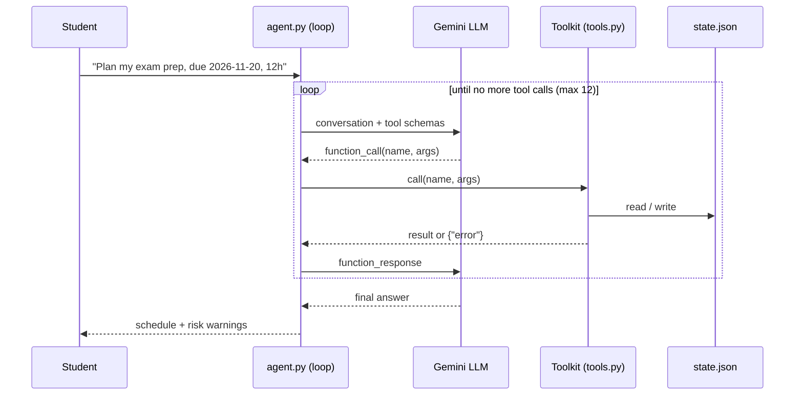

# Study Planner Agent

An autonomous AI agent that turns a student's goals ("I have a thermodynamics exam on 20 Nov, plan my week") into a concrete, adaptive study schedule. It is built on **Google Gemini function calling** and runs a visible **Think → Act → Observe** loop: the model decides which tool to call, the code executes it, and the result is fed back until the goal is met.

## What makes it an agent (not just a chatbot)

| Agent property | How it is implemented |
|---|---|
| Goal-driven | Takes a high-level request and decides the steps itself |
| Tool use | 10 tools that read and change real state (tasks, availability, schedule) |
| Multi-step reasoning | Loops up to 12 rounds per request (`run_turn` in `agent.py`) |
| Observation and self-correction | Tool errors come back as `{"error": ...}` and the model retries with fixed input |
| Memory | Conversation history in-session; tasks, settings and schedule persist in `data/state.json` |
| Safety limits | Step cap, file-read sandbox (`data/inputs` only), input validation on every tool |
| Reliable planning | Scheduling is deterministic code (`planner.py`), not LLM guesswork |

## Architecture / schema



Editable source: [`docs/architecture.svg`](docs/architecture.svg). Machine-readable tool schema (what the LLM sees): [`docs/tools_schema.json`](docs/tools_schema.json).



### Tools

| Tool | Purpose |
|---|---|
| `get_current_date` | Resolve "tomorrow", "next Friday" |
| `add_task` | Add an assignment / exam-prep item (title, subject, due date, hours, priority) |
| `list_tasks` | View tasks by status |
| `log_progress` | Record hours studied; auto-completes tasks |
| `delete_task` | Remove a task |
| `set_daily_hours` | Set daily study capacity |
| `block_date` | Mark a day unavailable |
| `generate_schedule` | Build the day-by-day plan and flag at-risk tasks |
| `get_plan_for_day` | Show one day's saved plan |
| `read_text_file` | Read a syllabus / deadline list from `data/inputs` |

### Scheduling algorithm

Earliest-deadline-first with priority tie-breaking. Each day's capacity is handed out in rotating 2-hour chunks, so subjects are interleaved. Tasks that cannot fit before their deadline are reported as `at_risk` with the missing hours, and the agent suggests fixes.

## Setup

```bash
git clone <your-repo-url>
cd study-planner-agent
python -m venv .venv && source .venv/bin/activate    # Windows: .venv\Scripts\activate
pip install -r requirements.txt
cp .env.example .env        # then paste your key into .env
```

Get a free Gemini API key at <https://aistudio.google.com/apikey>.

## Run

```bash
python agent.py              # interactive chat
python agent.py --verbose    # show full tool results
python agent.py --reset      # clear saved data first
```

Example session:

```
you> Read sample_syllabus.txt and add all my tasks. I can study 3 hours a day.
  -> [1] read_text_file({"filename": "sample_syllabus.txt"})
  -> [2] add_task(...)  (x5)
  -> [3] set_daily_hours({"hours": 3})
  -> [4] generate_schedule({"days": 30})
agent> Added 5 tasks. Heavy week ahead: Machine Design revision is at risk by 2.5h...

you> I'm travelling on 2026-11-08, replan.
  -> block_date(...) -> generate_schedule(...)
```

## Tests

```bash
python -m pytest -q          # 12 tests: planner, tools, storage, sandbox
python export_schema.py      # regenerate docs/tools_schema.json from the code
```

## Project structure

```
agent.py            LLM agent loop + CLI
tools.py            Toolkit: the 10 tools (docstrings = tool schema)
planner.py          Deterministic scheduling algorithm
storage.py          Atomic JSON persistence
export_schema.py    Generates docs/tools_schema.json
docs/               Architecture diagram + tool schema
data/inputs/        Sample syllabus for the agent to read
tests/              Unit tests
```

## Configuration

| Variable | Default | Meaning |
|---|---|---|
| `GEMINI_API_KEY` | none (required) | Google AI Studio key |
| `GEMINI_MODEL` | `gemini-3.8-flash` | Change if the model is retired or rate-limited |
| `PLANNER_DATA` | `data/state.json` | Where state is stored |

## Limitations and future work

- Single user, JSON storage (swap `storage.py` for SQLite to scale).
- No calendar sync; a Google Calendar tool would be a natural extension.
- Estimates come from the user; the agent could learn actual vs estimated hours from `log_progress`.
